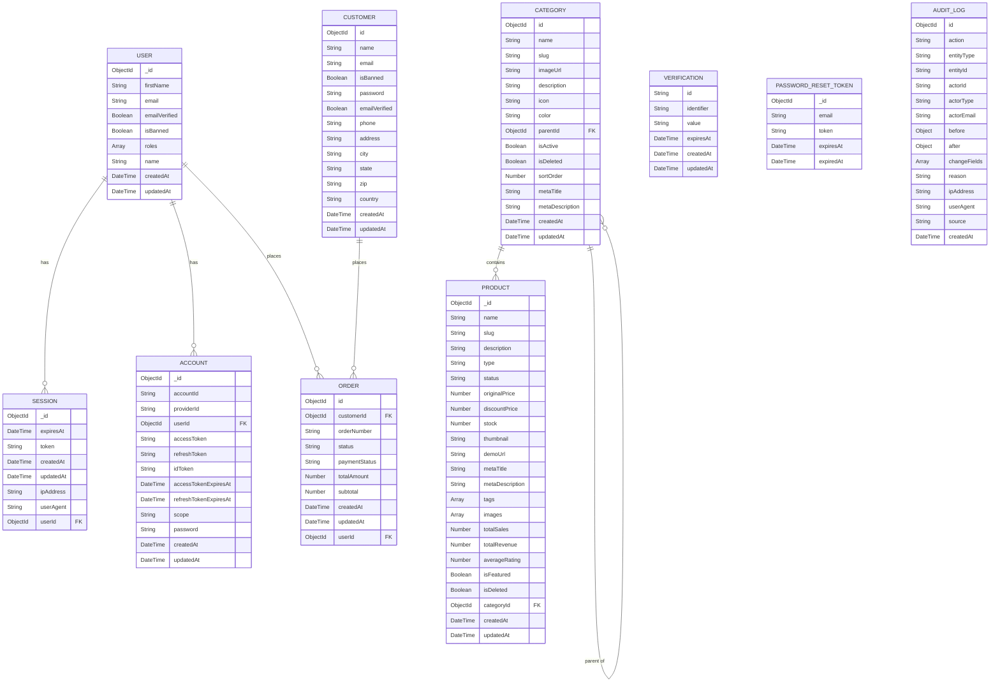

# ER Diagram

## How Our Data Entities Are Connected

*(Note: `VERIFICATION`, `PASSWORD_RESET_TOKEN`, and `AUDIT_LOG` are shown as standalone entities above since no explicit foreign key relation was described for them in the data modeling file - they are referenced by fields like `email` or `actorId`/`entityId`, not direct Prisma relations.)*

---

## Suggestions (Not part of original input - for your consideration)
- **Verification/PasswordResetToken linkage:** These currently connect to `User`/`Customer` only via `email`, not a direct foreign key relation. If they should be tied to a specific user record, consider adding a `userId` reference.
- **AuditLog linkage:** `actorId` and `entityId` are stored as plain strings rather than relations, which is common for audit logs (so records survive even if the original entity is deleted) - worth confirming this is intentional.
- **User vs Customer relation to Order:** As flagged in the data modeling file, `Order` connects to both `User` and `Customer` - worth clarifying if these represent the same person through different auth systems, or genuinely separate relationships (e.g., staff-assisted order creation vs. customer self-checkout).
- **Missing entities for a complete e-commerce ER diagram:** As noted in the previous file, `Cart`/`CartItem`, `OrderItem` (line items within an order), `Payment`/`Transaction` (for SSLCommerz), and `Review` are not yet modeled - once added, they'll each need relations drawn here (e.g., `ORDER ||--o{ ORDER_ITEM`, `PRODUCT ||--o{ REVIEW`, `ORDER ||--|| PAYMENT`).
- **Category self-relation:** Drawn as `CATEGORY ||--o{ CATEGORY` for parent-child (subcategories) - confirm this matches the intended use of `parentId`.